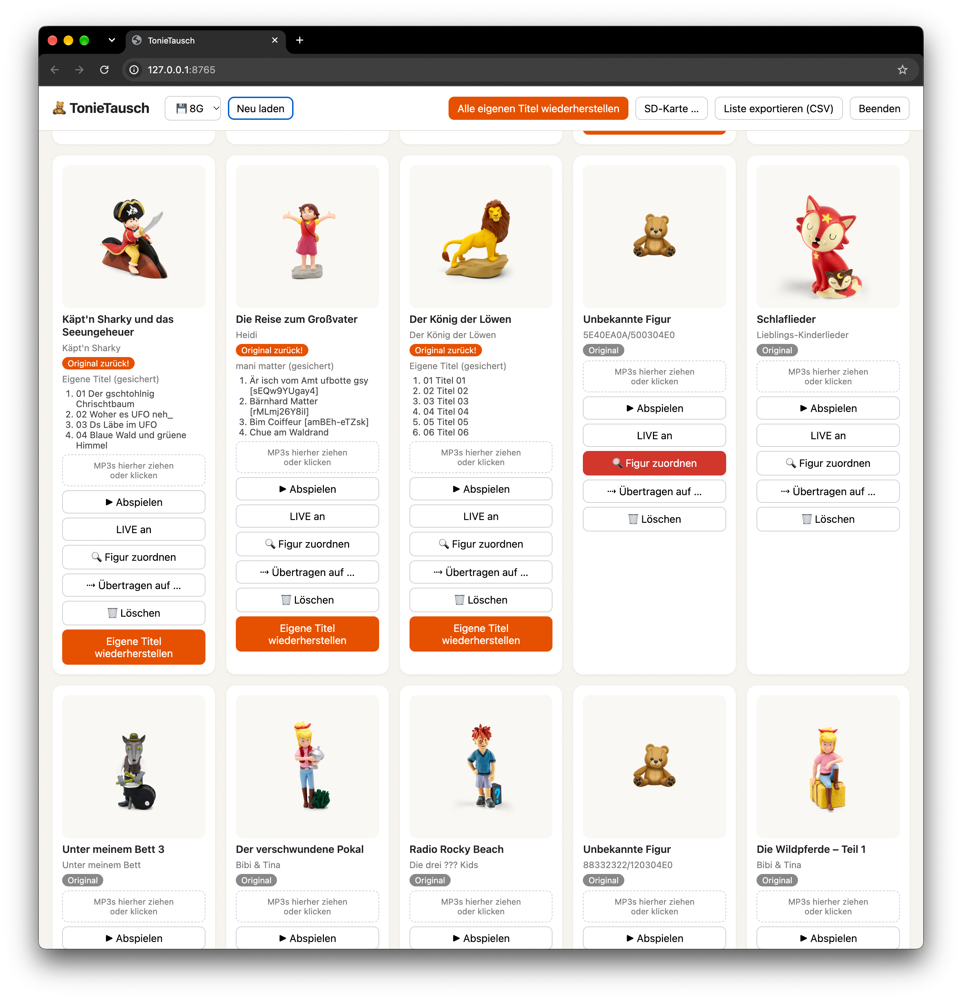

# TonieTausch

Kleine App für **macOS und Windows**, mit der du Toniebox-Figuren eigene Hörspiele und Musik zuweist – direkt auf der SD-Karte der Box, ohne Cloud.

> **Inoffizielles Hobbyprojekt.** Nicht mit tonies SE oder der Boxine GmbH verbunden und nicht von ihnen unterstützt. „Toniebox“ und „Tonie“ sind Marken ihrer jeweiligen Inhaber. Nutzung auf eigenes Risiko und nur mit eigenen, rechtmässig erworbenen Inhalten. Das Öffnen der Box geschieht auf eigene Verantwortung.



## Funktionen

- Figuren der SD-Karte mit Bild und Namen anzeigen (über die Community-Liste `tonies.json`)
- MP3s per Drag & Drop auf eine Figur laden, Reihenfolge festlegen, jeder Titel wird ein Kapitel
- Originale automatisch sichern, „Original zurück“ und „Alle eigenen Titel wiederherstellen“
- Abspielen direkt in Chrome/Edge mit Kapitelliste
- Inhalt einer Figur auf eine andere übertragen, Figuren löschen und wiederherstellen
- Figuren manuell zuordnen (Avatar, Name), z. B. nach Änderungen mit anderen Tools
- LIVE-Flag (verstecktes Dateiattribut) anzeigen, setzen und entfernen
- Komplettsicherung der SD-Karte und neue Karte daraus vorbereiten
- Export aller Figuren und Titel als CSV
- Systemklänge in eigenem, zugeklappten Bereich

## Installation

Repo herunterladen (`git clone https://github.com/creisey/tonietausch.git` oder „Code → Download ZIP“) und im Repo-Ordner:

**macOS** (Apple Silicon und Intel, Terminal):
```bash
bash install/setup-mac.sh
```
Installiert bei Bedarf Homebrew, Python, ffmpeg und opus-tools und legt `TonieTausch.app` auf den Schreibtisch.

**Windows 10/11** (PowerShell):
```powershell
powershell -ExecutionPolicy Bypass -File install\setup-windows.ps1
```
Installiert bei Bedarf Python per winget und legt eine Verknüpfung `TonieTausch` auf den Desktop. ffmpeg und opusenc lädt TonieToolbox beim ersten Umwandeln automatisch.

**Update:** Neuen Stand holen (`git pull` oder neues ZIP) und das Setup erneut ausführen. Deine Daten bleiben erhalten.

## Bedienung

1. SD-Karte aus der (ausgeschalteten) Box nehmen und in den Computer stecken.
2. TonieTausch starten – die Oberfläche öffnet sich im Browser (Chrome empfohlen).
3. MP3s auf eine Figur ziehen, Reihenfolge festlegen, „Auf die Figur laden“.
4. TonieTausch beenden, Karte sicher auswerfen und zurück in die Box.

**Wichtig:**
- Eine Figur erscheint erst, wenn sie einmal auf der Box gespielt wurde.
- Ist die Box online, lädt sie für Original-Figuren wieder das Original. Lass die Box offline oder nutze „Alle eigenen Titel wiederherstellen“.
- Karte nur bei ausgeschalteter Box entnehmen und am Computer immer auswerfen.
- Unter Windows lassen sich nur Karten bis 32 GB als FAT32 vorbereiten.

## Daten

Alle Daten (Bibliothek, Sicherungen, eigene Titel) liegen in `Dokumente/TonieTausch-Daten` und niemals im Repo.

## Danke

- [TonieToolbox](https://github.com/TonieToolbox/TonieToolbox) für die Umwandlung ins Tonie-Format
- [toniebox-reverse-engineering](https://github.com/toniebox-reverse-engineering) für `tonies-json` und das Wissen über das Dateiformat

## Lizenz

MIT – siehe [LICENSE](LICENSE).
